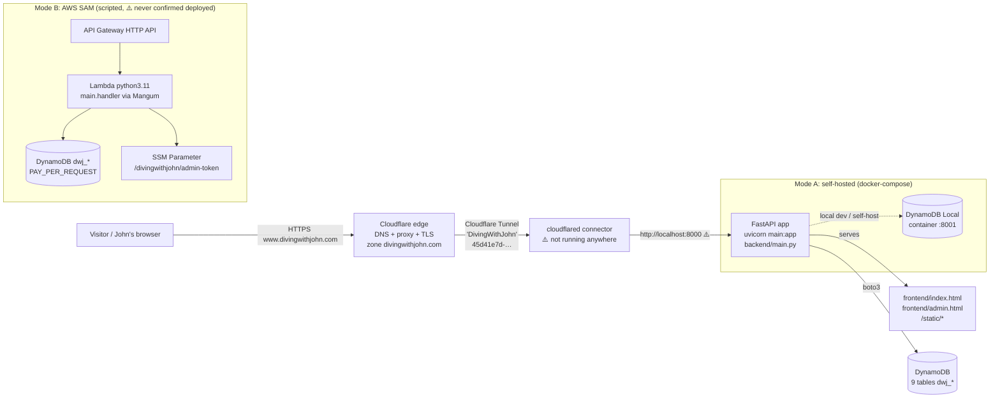

# Diving with John: handoff README

Website for **Diving with John**, AIDA freediving courses and trips (Catalina Island and Palos Verdes, per the newest copy).
Public domain: **divingwithjohn.com** (served at **www.divingwithjohn.com**).
Owner: **Afonso Miu** (GitHub `amiu888`). The instructor and client is **John**.

This document is meant to let a new developer pick the project up cold. Everything here was checked on **11/21/2026**. Items marked **⚠️ unverified** or listed in [Known unknowns](#known-unknowns--ask-afonso) could not be confirmed.

> **Status on 11/21/2026: the site is DOWN.** `https://www.divingwithjohn.com` returns Cloudflare **error 1033** (HTTP 530), which means the Cloudflare Tunnel behind it has no running connector. The apex `divingwithjohn.com` has **no A/AAAA/CNAME record**, so it doesn't resolve at all. See [Troubleshooting](#troubleshooting).

---

## 1. Overview

A single-page marketing site with a small admin panel:

- **`/`** is the public landing page (`frontend/index.html`). It covers the hero, about, courses, dive sites, how it works, testimonials, gallery, FAQ and contact. The dynamic blocks are fetched from the JSON API.
- **`/admin.html`** is the admin panel (`frontend/admin.html`), protected by a shared admin token. John or Afonso use it to edit courses, testimonials, gallery, FAQ and locations, to toggle page sections, and to read contact messages, bookings and signups.
- **`/api/*`** and **`/admin/*`** form a FastAPI JSON API backed by DynamoDB.
- **`/sitemap.xml`** and **`/robots.txt`** are generated from `SITE_HOST` and the course list.

One Python process (FastAPI) serves both the HTML and the API. There is no separate frontend build.

## 2. Architecture

The code supports two hosting modes. **Mode A is the one wired to the domain.** Mode B (AWS) is fully scripted, but there's no evidence it was ever deployed.



Request flow (Mode A): browser → Cloudflare (TLS terminates at the edge) → Cloudflare Tunnel → `cloudflared` on the host machine → FastAPI on a local port → DynamoDB (Local in docker, or real AWS if `DYNAMODB_ENDPOINT_URL` is unset).

## 3. Tech stack

| Layer | What |
|---|---|
| Frontend | Plain HTML/CSS/vanilla JS in `frontend/`. Google Fonts. No framework, no bundler, no build step. The original layout was a snapshot exported from Framer. |
| Backend | Python 3.11, FastAPI, Mangum (Lambda adapter), boto3, pydantic v2 (+ email-validator), python-dotenv. `Authlib` and `Jinja2` are installed but unused. |
| Data | DynamoDB: 9 tables prefixed `dwj_`. Local dev uses the `amazon/dynamodb-local` image. The original scaffold used SQLite (`divingwithjohn.db`); that path is obsolete. |
| Hosting | Cloudflare DNS + Cloudflare Tunnel to a self-hosted app (Mode A), or AWS SAM: Lambda + API Gateway + DynamoDB + SSM (Mode B). |
| Dev env | Docker Compose; VS Code devcontainer in `.devcontainer/`. |
| CI/CD | **None.** There are no GitHub Actions workflows, and every deploy is manual. |

## 4. Repo layout

```
divingwithjohn/
├── backend/
│   ├── main.py            # FastAPI app: all routes, DynamoDB access, admin auth, serves frontend
│   ├── models.py          # Pydantic request models
│   ├── db_init.py         # Creates the 9 dwj_* tables if missing + seeds sample content
│   ├── requirements.txt
│   ├── Makefile           # SAM build hook (copies frontend/ into the Lambda bundle)
│   ├── README.md          # (old, SQLite-era notes)
│   └── .env               # local env vars, git-ignored, NOT in repo
├── frontend/
│   ├── index.html         # public site (inline CSS + JS, fetches /api/*)
│   ├── admin.html         # admin panel (token login, CRUD UI)
│   └── test.html          # leftover CSS smoke test, safe to delete
├── template.yaml          # AWS SAM template (Lambda, HTTP API, 9 DynamoDB tables, SSM read policy)
├── docker-compose.yml     # app + DynamoDB Local
├── Dockerfile             # python:3.11-slim; runs db_init.py then uvicorn on :8000
├── .devcontainer/         # VS Code devcontainer (python 3.11, ports 8000/3000)
├── deploy/
│   ├── aws_lambda.md      # AWS SAM walkthrough
│   └── cloudflare_pages.md# old idea (static on Pages), NOT what is used
├── DEVELOPMENT.md         # older developer guide (superseded by this README)
└── package-lock.json      # empty stub, no Node deps
```

### API routes (`backend/main.py`)

| Public | Admin (header `x-admin-token` required) |
|---|---|
| `POST /api/contact` (name, email, message) | `GET /admin/students`, `GET /admin/contacts`, `GET /admin/bookings` |
| `POST /api/booking` (course_id, user_email, date) | `GET/POST /admin/courses`, `PUT/DELETE /admin/courses/{id}`, `POST …/{id}/suspend\|archive\|restore` |
| `POST /api/signup` (email, name, provider…) | `GET/POST /admin/testimonials`, `PUT/DELETE …/{id}`, `POST …/{id}/toggle` |
| `GET /api/testimonials`, `/api/gallery`, `/api/faq`, `/api/locations`, `/api/sections` | same CRUD + toggle for `/admin/gallery`, `/admin/faq`, `/admin/locations` |
| `GET /sitemap.xml`, `GET /robots.txt`, `GET /`, `GET /admin.html`, `/static/*` | `GET /admin/sections`, `POST /admin/sections/{key}/toggle` |

### DynamoDB tables

`dwj_contacts`, `dwj_courses`, `dwj_bookings`, `dwj_testimonials`, `dwj_gallery`, `dwj_faq`, `dwj_locations` (all keyed by `id`, S), `dwj_users` (keyed by `email`), and `dwj_sections` (keyed by `key`). All use on-demand billing.

## 5. Local development

Requires Docker Desktop.

```bash
git clone https://github.com/amiu888/divingwithjohn.git
cd divingwithjohn
export ADMIN_TOKEN='<pick-a-local-token>'   # don't rely on the compose default
docker compose up --build                   # app on :8000, DynamoDB Local on :8001
# the app container runs db_init.py on start (creates + seeds tables)
open http://localhost:8000            # site
open http://localhost:8000/admin.html # admin, log in with $ADMIN_TOKEN
docker compose down
```

DynamoDB Local runs with `-sharedDb` and no volume (the db file lives inside the container), so **data is lost when the container is removed**.

Without Docker for the app (DynamoDB Local still in docker):

```bash
docker run -d -p 8001:8000 amazon/dynamodb-local -jar DynamoDBLocal.jar -sharedDb
cd backend && python3.11 -m venv .venv && source .venv/bin/activate
pip install -r requirements.txt
cp /dev/null .env && cat >> .env <<'ENV'
DYNAMODB_ENDPOINT_URL=http://localhost:8001
AWS_ACCESS_KEY_ID=local
AWS_SECRET_ACCESS_KEY=local
AWS_DEFAULT_REGION=us-east-1
ADMIN_TOKEN=<pick-a-local-token>
SITE_HOST=http://localhost:8000
ENV
python db_init.py
uvicorn main:app --reload --port 8000
```

## 6. Build and deploy

There is **no CI**. Pushing to `main` deploys nothing. Use one of the manual paths below.

### Mode A: self-hosted behind Cloudflare Tunnel (how www.divingwithjohn.com is wired)

1. On the host machine (a Mac or Linux box that stays on), run the app on a local port:
   ```bash
   cd divingwithjohn
   export ADMIN_TOKEN='<real-admin-token>' SITE_HOST='https://www.divingwithjohn.com'
   docker compose up -d --build        # serves on :8000
   ```
   To persist data, either add a volume to `dynamodb-local` and pass `-dbPath /data`, or unset `DYNAMODB_ENDPOINT_URL` and point at real AWS DynamoDB with real IAM credentials.
   ⚠️ On the Mac Studio, port **8000 is already used** by another app (aegis-desk API), so use another port there, e.g. change the compose mapping to `"8010:8000"`.
2. Run the tunnel connector for tunnel **`DivingWithJohn`** (ID `45d41e7d-5acc-44ba-821f-a6b5c7d1125d`, created 5/23/2026 in Afonso's Cloudflare account):
   - If the tunnel is **dashboard-managed** (Zero Trust → Networks → Tunnels → DivingWithJohn), copy the connector install command from the dashboard (`cloudflared service install <TOKEN>`) and check that its Public Hostname `www.divingwithjohn.com` points at the port from step 1. **The tunnel token is a secret: never commit or paste it anywhere.**
   - If it's **locally managed**, it needs a credentials file `~/.cloudflared/45d41e7d-….json` (not present on the Mac Studio or the MacBook as of 11/21/2026) and a config like:
     ```yaml
     tunnel: 45d41e7d-5acc-44ba-821f-a6b5c7d1125d
     credentials-file: /Users/<you>/.cloudflared/45d41e7d-5acc-44ba-821f-a6b5c7d1125d.json
     ingress:
       - hostname: www.divingwithjohn.com
         service: http://127.0.0.1:8000
       - hostname: divingwithjohn.com
         service: http://127.0.0.1:8000
       - service: http_status:404
     ```
     `cloudflared tunnel --config <that.yml> run DivingWithJohn`, ideally wrapped in a LaunchAgent/systemd unit so it survives reboots.
3. Verify: `cloudflared tunnel info DivingWithJohn` shows connections, and `curl -I https://www.divingwithjohn.com` returns 200.

## 6a. Current production setup on the Mac Studio (set up 11/21/2026)

The app runs from the Studio checkout `~/Documents/miulabs/divingwithjohn` with Docker (OrbStack, which starts at login). Runtime files live **outside the repo** in `~/.divingwithjohn/` (chmod 700):

| File | Purpose |
|---|---|
| `~/.divingwithjohn/app.env` (chmod 600) | `ADMIN_TOKEN`, `SITE_HOST`. **Secret; never commit.** |
| `~/.divingwithjohn/compose.override.yml` | binds app to `127.0.0.1:8095`, DynamoDB Local to `127.0.0.1:8096`, persists DynamoDB in the docker volume `divingwithjohn_dwj-dynamodb-data` (`-dbPath`), `restart: unless-stopped` |
| `~/.divingwithjohn/start-app.sh` | idempotent `docker compose ... up -d` (starts OrbStack if needed) |
| `~/.divingwithjohn/logs/` | `app-agent.log`, `tunnel.log` |
| `~/.cloudflared/divingwithjohn.yml` | locally managed ingress for tunnel `DivingWithJohn`: `www.divingwithjohn.com → http://localhost:8095` |

LaunchAgents (in `~/Library/LaunchAgents/`):
- `com.afonso.divingwithjohn-app` runs `start-app.sh` at login and every 5 min (a watchdog).
- `com.afonso.divingwithjohn-tunnel` runs `cloudflared tunnel --config ~/.cloudflared/divingwithjohn.yml run 45d41e7d-…` with KeepAlive.

Common commands (on the Studio):

```bash
cd ~/Documents/miulabs/divingwithjohn
C="docker compose -f docker-compose.yml -f $HOME/.divingwithjohn/compose.override.yml --env-file $HOME/.divingwithjohn/app.env"
$C ps                      # status
$C logs -f app             # app logs
$C up -d --build           # redeploy after editing frontend/ or backend/
curl -I http://127.0.0.1:8095/
launchctl kickstart -k gui/$(id -u)/com.afonso.divingwithjohn-tunnel   # restart tunnel
```

### ⚠️ DNS routing gotcha (found 11/21/2026)

`www.divingwithjohn.com` is **not** routed to the `DivingWithJohn` tunnel. Its DNS record points at the **dashboard-managed `mac-studio` tunnel** (`d90ecb83-…`), whose remote config is:
`studio.miulabs.app → localhost:3000`, `scantabsai.miulabs.app → http://10.0.2.63`, `www.divingwithjohn.com → localhost:8002`.
Running the `DivingWithJohn` connector alone therefore still gives error 1033. You can fix it either way:
1. Repoint DNS: `cloudflared tunnel route dns --overwrite-dns DivingWithJohn www.divingwithjohn.com`. This is a DNS change, so it needs the owner's OK.
2. Or serve on port 8002 and run a connector for the `mac-studio` tunnel. Note that this also re-publishes `studio.miulabs.app` and `scantabsai.miulabs.app`.

### Mode B: AWS serverless (SAM)

Scripted in `template.yaml`. There's no `samconfig.toml` in any checkout, so it was probably never deployed (⚠️ unverified).

```bash
brew install awscli aws-sam-cli
aws configure                                    # AWS account owner: ⚠️ ask Afonso
aws ssm put-parameter --name /divingwithjohn/admin-token --type SecureString --value '<real-admin-token>'
sam build                                        # build ON x86_64 or use --use-container
sam deploy --guided                              # stack: divingwithjohn, set SiteHost=https://www.divingwithjohn.com
cd backend && AWS_DEFAULT_REGION=<region> python db_init.py   # first deploy only (tables already exist via SAM; this seeds)
# later: sam build && sam deploy
```

Notes:
- The Lambda architecture is x86_64. The old `.aws-sam/` build on the MacBook contains **aarch64 / cpython-39** native wheels (e.g. cffi), which won't load on Lambda. Build with `sam build --use-container`.
- `template.yaml` has **no `AdminToken` parameter**, even though `deploy/aws_lambda.md` says there is one. The token comes only from SSM `/divingwithjohn/admin-token`. The SSM policy ParameterName lacks the leading slash; check that the read works after the first deploy.
- To put it on the domain: create an API Gateway custom domain (ACM cert) and a proxied CNAME in Cloudflare, or keep Cloudflare in front and point the tunnel/Worker at the API URL. Either way **this changes DNS, so get Afonso's OK first.**

## 7. Domain, DNS and Cloudflare

| Item | Value (11/21/2026) |
|---|---|
| Registrar | ⚠️ unknown. Ask Afonso (could be Cloudflare Registrar). |
| DNS | Cloudflare, nameservers `hayes.ns.cloudflare.com`, `izabella.ns.cloudflare.com` |
| Cloudflare account | Afonso's (free plan), which also holds `amiu.org` and `miulabs.app` |
| `www.divingwithjohn.com` | Proxied (orange cloud) CNAME to the **`mac-studio`** tunnel (`d90ecb83-…`, dashboard-managed, ingress → `localhost:8002`). **Not** the `DivingWithJohn` tunnel. See §6a. |
| `divingwithjohn.com` (apex) | **No record**, so it doesn't resolve. Add a proxied record to the tunnel, or a redirect rule apex → www. |
| MX / SPF / DMARC | **None.** No email on this domain. |
| SSL | Cloudflare Universal SSL at the edge (cert served for www). Origin traffic goes through the tunnel, so no origin cert is needed. |
| Other Cloudflare products | No Pages project or Worker was found for this domain; the free-plan account's Pages/Workers are for miulabs.app. KV/D1/R2/Turnstile aren't used by the code. ⚠️ Not confirmed in the dashboard (no API token on hand). |
| Tunnels in the account | `DivingWithJohn` (connector on Mac Studio since 11/21/2026), `mac-studio` (0; carries www + studio/scantabsai.miulabs.app), `renren` (photos.amiu.org, running on Mac Studio), `turenas_tunnel` (NAS, running) |

## 8. Environment variables and secrets

Names only. **Never commit values.** `.env` is git-ignored.

| Name | Used by | Where it lives |
|---|---|---|
| `ADMIN_TOKEN` | admin auth (`x-admin-token` header) | local `backend/.env` (Mac Studio + MacBook checkouts), or exported for docker compose. **In AWS mode it's unset and the app reads SSM.** |
| SSM `/divingwithjohn/admin-token` | admin auth in Lambda | AWS SSM Parameter Store (SecureString), ⚠️ if AWS was ever set up |
| `SITE_HOST` | sitemap.xml / robots.txt | `.env` / compose / SAM parameter `SiteHost` |
| `DYNAMODB_ENDPOINT_URL` | points boto3 at DynamoDB Local | `.env` / compose. **Unset means real AWS.** |
| `AWS_ACCESS_KEY_ID`, `AWS_SECRET_ACCESS_KEY` | boto3 | `local`/`local` for DynamoDB Local; real keys from `aws configure` or the Lambda IAM role in AWS |
| `AWS_DEFAULT_REGION` | boto3 | `.env` / SAM sets it from the stack region |
| Cloudflare Tunnel token / credentials JSON for `DivingWithJohn` | cloudflared connector | Cloudflare Zero Trust dashboard (Afonso's account). **Not on disk anywhere found.** Secret. |

⚠️ **Security note:** older docs and `docker-compose.yml` in this **public** repo contain a default admin token. Treat that value as compromised: choose a new one for any real deployment, and remove the compose default.

## 9. Third-party services and accounts

| Service | Purpose | Owner |
|---|---|---|
| GitHub `amiu888/divingwithjohn` (public) | source | Afonso Miu |
| Cloudflare (free plan) | DNS, proxy/TLS, Tunnel | Afonso Miu |
| Domain registrar | divingwithjohn.com registration/renewal | ⚠️ ask Afonso |
| AWS (optional, Mode B) | Lambda, API Gateway, DynamoDB, SSM | ⚠️ unknown, possibly none yet |
| Google Fonts | web fonts (loaded from fonts.googleapis.com / gstatic) | public CDN, no account |
| Analytics | **none** in the code (no GA, no Cloudflare Web Analytics snippet) | n/a |
| Email delivery | **none.** Contact-form messages are only saved in `dwj_contacts`, and no one is emailed. | n/a |

## 10. Content-editing guide (for John / non-devs)

1. Open `https://www.divingwithjohn.com/admin.html` and enter the admin token.
2. Tabs:
   - **Courses:** add, edit, suspend, archive or restore. Archived courses drop out of the sitemap.
   - **Testimonials / Gallery / FAQ / Locations:** add, edit, delete, or toggle visible/hidden. `sort_order` controls the order (lower comes first).
   - **Sections:** show or hide whole homepage blocks (hero, about, courses, locations, process, testimonials, gallery, faq, contact).
   - **Contacts / Bookings / Students:** read-only inbox of form submissions. Check it regularly, because nothing gets emailed.
3. Static copy (headlines, about text, images, videos) is hard-coded in `frontend/index.html`. Changing it needs a code edit and redeploy (restart the container / `sam deploy`).
4. Images and videos go under `frontend/` and are served at `/static/<path>`, for example `frontend/media/hero.jpg` → `/static/media/hero.jpg`.

## 11. Troubleshooting

| Symptom | Cause | Fix |
|---|---|---|
| `error code: 1033` / HTTP 530 on www | Tunnel `DivingWithJohn` has no connector | Start `cloudflared` for that tunnel on the host (§6 Mode A). Check with `cloudflared tunnel info DivingWithJohn`. |
| HTTP 502 / 1016 after the tunnel is up | Tunnel is up but the app isn't listening on the configured port | `docker compose ps`, `curl localhost:8000`, and fix the port in the tunnel's ingress |
| `divingwithjohn.com` (no www) doesn't load | No apex DNS record | Add a proxied apex record / redirect rule (DNS change, needs Afonso's OK) |
| Admin login says "Invalid token" | `ADMIN_TOKEN` env differs, or the app cached an old token (cached per process) | Set the env and restart the app; in AWS update SSM and redeploy/cold-start |
| Admin returns 500 in AWS | SSM parameter missing or IAM can't read it | `aws ssm get-parameter --name /divingwithjohn/admin-token --with-decryption` (don't paste the output); check the policy path |
| Sections/FAQ/etc. empty | Tables not seeded | `python db_init.py` against the right endpoint/region |
| All content gone after restart | DynamoDB Local has no persistent volume | Add a volume + `-dbPath`, or use real DynamoDB |
| Lambda import error (cffi / pydantic_core) | Built on ARM Mac | `sam build --use-container` |
| Fonts/styles look wrong | `test.html` exists to sanity-check CSS | open `/static/test.html` |

## 12. Machines and local copies (as of 11/21/2026)

- **Mac Studio** (`~/Documents/miulabs/divingwithjohn`): tracks `origin/main`, with **uncommitted work**. There's a full redesign of `frontend/index.html`, last edited 11/21/2026 (new copy for Catalina/Palos Verdes, Archivo font, depth-gauge theme), plus an untracked `frontend/media/` folder (about 33 MB of jpg/mp4). **It isn't in GitHub yet.**
- **MacBook** (`~/Workspace/divingwithjohn`): clean `main` plus an old `.aws-sam/` build and a stale SQLite `divingwithjohn.db`.
- Neither machine has `aws`, `sam` or `wrangler` installed. `cloudflared` is installed only on the Mac Studio, and no connector for `DivingWithJohn` is configured there.

## Known unknowns / ask Afonso

1. **Where did the `DivingWithJohn` tunnel connector run**, and was it dashboard-managed (token) or locally managed (credentials JSON)? Which local port did it point to?
2. **Which machine should host the site** going forward (Mac Studio, NAS, or AWS)? Should it move to AWS SAM or Cloudflare Pages + Workers/D1 instead of a self-hosted tunnel?
3. **Was the AWS SAM stack ever deployed?** If so: which AWS account, which region, and whether the SSM parameter exists.
4. **Where is the production data?** If it was DynamoDB Local without a volume, earlier contacts/bookings may be gone.
5. **Registrar** for divingwithjohn.com and its renewal date.
6. Should the **apex** `divingwithjohn.com` resolve (redirect to www)?
7. Should the **Mac Studio redesign** (uncommitted `index.html` + `frontend/media/`) be committed? 33 MB of video may be better on R2 or a CDN than in git.
8. Rotate the **admin token** (an old default is public in git history), and decide whether the repo should stay public.
9. Does John want contact-form **email notifications** (e.g. via Cloudflare Email Routing / an SMTP service), and **analytics**?
10. Who besides Afonso (e.g. John) needs access to Cloudflare / GitHub / the admin panel?
